<p align="center">
  
</p>
<p align="center">
  
</p>
<br>
---
 
### ˚ ༘ about me
 
```
╭──────────────────────────────────────────────────╮
│                                                  │
│   🎓  3rd year Cybersecurity @ TUKE, Košice      │
│   🔐  network security · software · game dev     │
│   🌿  teaching kids to code @ Algonova           │
│   🪐  astrophysics · nature · design · pixel art │
│   🐈  planet Earth                               │
│                                                  │
╰──────────────────────────────────────────────────╯
```
 
---
 
### ✦ projects
 
```
  🌐  portfolio      →  tamarabereznakova.github.io     [ HTML · CSS · JS ]
  🐍  slitherlink    →  slitherlinko.onrender.com       [ Java · Spring Boot · PostgreSQL ]
  📚  it4kt-builder  →  github.com/tamarabereznakova    [ Python ]
  🎮  pixel art game →  in progress ...                 [ Unity · C# ]
```
 
---
 
### ˚ ༘ skills
 


 
---
 
### ✦ github stats
 
<p align="center">
  
  &nbsp;
  
</p>
---
 
### ✦ find me
 
<p align="center">
  <a href="https://linkedin.com/in/tamara-bereznakova">
    
  </a>
  &nbsp;
  <a href="https://tryhackme.com/p/heartway">
    
  </a>
  &nbsp;
  <a href="https://tamarabereznakova.github.io/web-site/">
    
  </a>
</p>
<br>
<p align="center">
  
</p>
