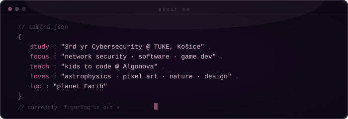

  

  

 

⋆｡𖦹°⭒˚｡⋆ ✮⋆˙ · · · · · · · · · · · · · · · · · · · · · · · · ˙⋆✮ ⋆｡𖦹°⭒˚｡⋆

 

  

⋆.˚ ☾⭒.˚ · · · · · · · · · · · · · · · · · · · · · ˚.⭒☾ ˚.⋆

 

  

˖ ₊⋆.˚⋆ ‧. ݁ ݁˚. ݁ · · · · · · · · · · · · · · · · · ₊⋆.˚⋆ ‧. ݁ ₊˖

 

  

⋆˚✰ ݁˖⭑.ᐟ · · · · · · · · · · · · · · · · · · · · · · · · .ᐟ⭑˖ ݁ ✰˚⋆

 

  
  &nbsp;&nbsp;
  

*ੈ✩‧₊˚༺☆༻*ੈ✩‧₊˚ · · · · · · · · · · · · · · *ੈ✩‧₊˚༺☆༻*ੈ✩‧₊˚

 

  
  &nbsp;
  
  &nbsp;
  

 

⋆｡𖦹°⭒˚｡⋆ · · · · · · · · · · · · · · · · · · · · · · · · · ⋆｡𖦹°⭒˚｡⋆

 

  

